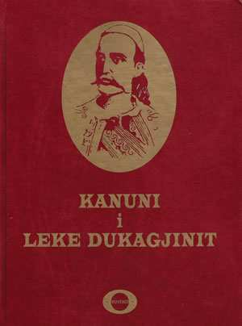

# Kanuni i Lekë Dukagjinit

The customary law of the highlands of northern Albania, collected by Shtjefën Gjeçovi and published in Shkodër in 1933.

- [**Shqip**](sq/) — Teksti origjinal i vitit 1933
- [**English**](en/) — Translation of the 1933 text, with a glossary
